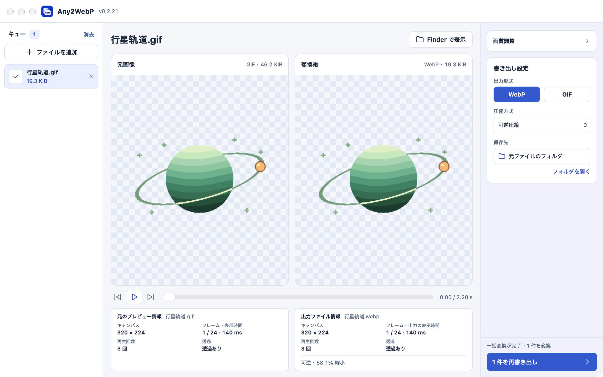

# Any2WebP

[English](README.md) · [简体中文](README.zh-CN.md) · 日本語

**Mac で使える、シンプルな WebP 画像変換アプリ。** 写真、スクリーンショット、アニメーション、動画の一部を WebP や GIF に変換できます。ファイルをドラッグして、形式を選んで一括変換。MIT ライセンスのオープンソースで、無料で使えます。

[macOS 版をダウンロード](https://ixiehao.github.io/Any2WebP/ja/download/) · [公式サイト](https://ixiehao.github.io/Any2WebP/ja/) · [MIT ライセンス](LICENSE)

*下の比較には、画面にある GIF と可逆 WebP を使っています。*

## 3 ステップで変換

1. 「**ファイルを変換**」を選ぶか、ウィンドウにファイルをドラッグします。複数の静止画も 1 枚ずつ書き出せます。
2. WebP または GIF を選びます。WebP の既定は可逆圧縮です。どちらの形式でも目標サイズを指定できます。
3. 「**書き出す**」を選びます。共通のタイムラインで変換前後を比較し、実際の容量、フレーム表示時間、再生回数、透明度を確認できます。

変換は Mac 上で行い、WebP のエンコードには同梱の libwebp を使います。長いアニメーションや目標サイズを指定した書き出しでは、処理に時間がかかる場合があります。

## アニメーションを作る・編集する

| やりたいこと | 操作 |
| --- | --- |
| 複数の画像をアニメーションにする | 「**画像を合成**」で JPG や PNG などを選び、サムネイルをドラッグして並べ替えます。 |
| 動画の一部をアニメーションにする | 「**動画をアニメ化**」で MP4、MOV、WebM を選びます。タイムラインで範囲を指定し、フレームレートと長辺を設定します。 |
| アニメーションを編集する | GIF、アニメーション WebP、APNG を開き、「**フレームを編集**」を選びます。フレームの並べ替え、削除、挿入、差し替え、表示時間の調整ができます。 |

## アニメーションの形式を選ぶ

| | アニメーション WebP | アニメーション GIF |
| --- | --- | --- |
| 色と透明度 | フルカラーで半透明に対応 | 各フレーム最大 256 色。完全に透明か不透明 |
| 容量 | 可逆・非可逆圧縮が選べ、容量を抑えやすい | 単純な図に向く。複雑な画像では容量や色の段差が目立つことがある |
| 主な用途 | ウェブ向け、透過素材、動画の一部 | GIF のみ対応するサービスや従来のソフトウェア |

Any2WebP で **「青緑のハチドリ」** の GIF を可逆 WebP に書き出し、60 フレーム、透明な背景、3 秒のループを維持しています。

| [GIF · 1.03 MiB](docs/assets/hummingbird-loop.gif) | [WebP · 731.3 KiB](docs/assets/hummingbird-loop.webp) |
| --- | --- |
|  |  |

この例の WebP は GIF より **326.7 KiB（30.9%）** 小さくなりました。[公式サイトで比較を再生](https://ixiehao.github.io/Any2WebP/ja/#formats) · [Google の WebP FAQ](https://developers.google.com/speed/webp/faq)

## 静止画の形式を選ぶ

| 形式 | 特徴 | 主な用途 |
| --- | --- | --- |
| **WebP** | 可逆・非可逆圧縮が選べ、半透明に対応 | ウェブ画像、商品写真、容量を抑えたいスクリーンショット |
| **PNG** | 可逆圧縮で半透明に対応 | 文字の鮮明さを保ちたい画像、画面キャプチャ、透過素材 |
| **JPG / JPEG** | 非可逆圧縮。広く対応し、一般的な JPG に透明度はない | 写真、古い機器、JPG 指定のサービス |

Google の比較では、可逆圧縮の WebP は PNG より約 26%、非可逆圧縮の WebP は同程度の SSIM の JPEG より約 25～34% 小さくなりました。圧縮済みの JPG を WebP の可逆圧縮で書き出すと容量が増える場合があります。画質と実際の容量を比べて設定を選べます。[Google の WebP 概要](https://developers.google.com/speed/webp)

## インストールと対応形式

- **Apple Silicon 搭載の Mac と macOS 26.0 以降**が必要です。DMG を開き、Any2WebP を「アプリケーション」にドラッグします。署名についてはリリースノートをご確認ください。[GitHub Releases](https://github.com/ixiehao/Any2WebP/releases/latest)
- 画像の変換はそのまま使えます。動画の読み込みには FFmpeg と ffprobe が必要です。「ヘルプ → 依存ツールを確認…」から「動画の依存ツール」を開けます。Homebrew があればインストールや修復を行えます。
- JPEG、PNG、WebP、GIF、APNG、HEIC/HEIF、AVIF、TIFF、BMP、ICO、PSD、JPEG 2000、JPEG XL、MP4、MOV、WebM などを読み込めます。書き出しは WebP または GIF です。
- 英語、簡体字中国語、日本語に対応します。既定ではシステム設定に従い、macOS の「言語」メニューで変更できます。
- 「ヘルプ → アップデートを確認」で GitHub Releases の更新を確認できます。

[開発ドキュメント](docs/README.md) · [変更履歴](CHANGELOG.md) · [サポート](SUPPORT.md) · [プライバシー](PRIVACY.md) · [サードパーティーのライセンス](NOTICE.md)
