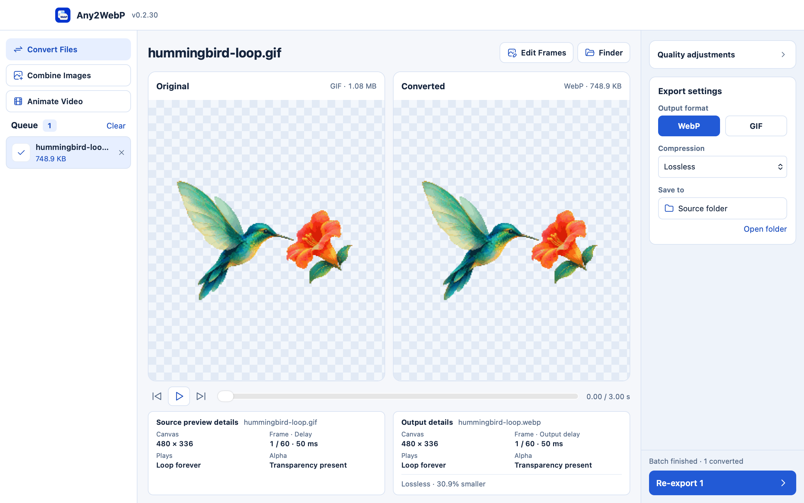

# Any2WebP

English · [简体中文](README.zh-CN.md) · [日本語](README.ja.md)

**A simple WebP image converter for Mac.** Turn photos, screenshots, animations, and video clips into WebP or GIF. Drag in your files, choose a format, and convert them quickly in a local batch. Any2WebP is free and open source under the MIT license.

[Download for macOS](https://ixiehao.github.io/Any2WebP/download/) · [Website](https://ixiehao.github.io/Any2WebP/) · [MIT license](LICENSE)

*The GIF and lossless WebP shown here are the files used in the comparison below.*

## Convert in three steps

1. Choose **Convert Files** or drag files into the window. Stills in a batch each export as their own file.
2. Select WebP or GIF. WebP defaults to lossless compression. For either format, you can set a target file size.
3. Choose **Export**. Compare frames on a shared timeline and check the actual output size, frame delays, play count, and transparency.

Conversion runs locally, and WebP encoding uses the bundled libwebp. Large animations and target-size exports may take longer because they process more frames or try multiple encodes.

## Create and edit animations

| What you want to do | How to do it |
| --- | --- |
| Animate a series of stills | Choose **Combine Images**, select JPG, PNG, or other supported images, and drag their thumbnails to change the natural filename order. |
| Animate part of a video | Choose **Animate Video** for an MP4, MOV, or WebM file. Trim it on the timeline and set the frame rate and output size. |
| Edit an existing animation | Open an animated GIF, WebP, or APNG and choose **Edit Frames**. Reorder, delete, insert, and replace frames, or adjust frame durations. |

## Animated images: WebP or GIF

| | Animated WebP | Animated GIF |
| --- | --- | --- |
| Color and transparency | True color with partial transparency | Up to 256 colors per frame and binary transparency |
| File size | Lossy and lossless options, often smaller | Works well for simple graphics, but complex scenes can take more space or show banding |
| Good for | Web animations, transparent graphics, and video clips | GIF-only platforms and older software |

Any2WebP exported **Teal Hummingbird** from GIF to lossless WebP, preserving its 60 frames, transparent background, and 3-second loop.

| [GIF · 1.03 MiB](docs/assets/hummingbird-loop.gif) | [WebP · 731.3 KiB](docs/assets/hummingbird-loop.webp) |
| --- | --- |
|  |  |

The WebP export is **326.7 KiB (30.9%) smaller** in this example. [Play the comparison on the website](https://ixiehao.github.io/Any2WebP/#formats) · [Google’s animated WebP FAQ](https://developers.google.com/speed/webp/faq)

## Still images: WebP, PNG, or JPG

| Format | What it offers | Good for |
| --- | --- | --- |
| **WebP** | Lossy or lossless compression with partial transparency | Web images, product photos, and smaller screenshots |
| **PNG** | Lossless compression with partial transparency | Crisp text, screenshots, interface graphics, and transparent artwork |
| **JPG / JPEG** | Lossy compression, wide compatibility, and typically no transparency | Photos, older devices, and sites that require JPG |

Google measured about 26% smaller files for lossless WebP versus PNG, and 25–34% smaller files for lossy WebP versus JPEG at comparable SSIM. A highly compressed JPG can grow when exported as lossless WebP. Compare the export and its actual size when choosing settings. [Google’s WebP overview](https://developers.google.com/speed/webp)

## Install and use

- Requires **Apple Silicon and macOS 26.0 or later**. Open the DMG and drag Any2WebP into Applications. Signing details are in the release notes. [GitHub Releases](https://github.com/ixiehao/Any2WebP/releases/latest)
- Image conversion works out of the box. Video import uses FFmpeg and ffprobe. Open **Help → Check Dependencies** to view **Video Dependencies** and check or repair the tools.
- Supported inputs include JPEG, PNG, WebP, GIF, APNG, HEIC/HEIF, AVIF, TIFF, BMP, ICO, PSD, JPEG 2000, JPEG XL, MP4, MOV, and WebM. Export to WebP or GIF.
- English, Simplified Chinese, and Japanese are available. The app follows the system by default, with manual selection in the macOS **Language** menu.
- Use **Help → Check for Updates** to check GitHub Releases.

[Development and testing](docs/README.md) · [Changelog](CHANGELOG.md) · [Support](SUPPORT.md) · [Privacy](PRIVACY.md) · [Third-party notices](NOTICE.md)
