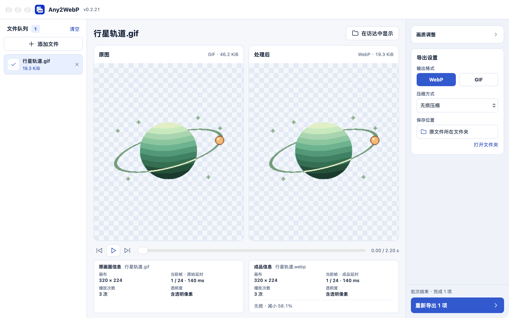

# Any2WebP

[English](README.md) · 简体中文 · [日本語](README.ja.md)

**把图片和视频片段转成 WebP 或 GIF，把文件压到指定体积。** Any2WebP 是一个在本机处理文件的 macOS 原型。两侧预览共用同一条时间轴，可逐帧检查透明边缘和帧延时。

## 打开和使用

需要 Apple Silicon Mac 和 macOS 26.0 或更新版本。公开发行以 [GitHub Releases](https://github.com/ixiehao/Any2WebP/releases) 为准。如暂无安装包，可按[构建说明](docs/DEVELOPMENT.md)从源码运行，或[在本机制作试用 DMG](docs/RELEASING.md#本机试用)。打开 DMG 后，将 Any2WebP 拖到「应用程序」。本机试用包使用临时签名，正式分发包使用 Developer ID 签名及 Apple 公证。

图片处理引擎随应用安装。视频使用同一套安装中的 FFmpeg 和 ffprobe。可从 macOS 菜单栏选择「帮助 → 视频依赖」查看实际版本和路径。缺少或损坏时可主动选择「安装或修复」，应用会调用已有 Homebrew 并在完成后重新检查。没有 Homebrew 时，面板提供[官网](https://brew.sh/)与重新检查入口。

界面支持简体中文、英语和日语。默认跟随系统首选语言，也可在 macOS 菜单栏的「语言」菜单切换。顶栏显示当前版本，发现新版本后右侧才会出现提示。可以从 macOS 菜单栏选择「Any2WebP → 检查更新」手动查询 GitHub Releases，点击「查看发布页」可在浏览器中查看更新说明并下载。工作区左侧是队列，中间是同步预览与视频时间轴，右侧是画质和导出设置。

1. 点「转换文件」或拖入 JPG、PNG、GIF、WebP、MP4、MOV、WebM 等文件，可以混合加入队列。加入多张静态图时，每张单独导出为静态 WebP 或单帧 GIF。
2. 点「视频转动图」选择一段视频，直接进入剪切窗口。对队列里已有的视频，也可以点「剪切片段」。在独立窗口播放或拖动查看源画面，拖动两个手柄或输入毫秒时间码、秒数来设定范围，也可用「−5」「+5」按源视频帧率微调。保留时长会即时更新。缩略图时间轴可缩放、横向滚动，靠近边缘拖动时自动平移。点击「确认剪切」才会更新主窗口的同步预览与下次导出的范围。剪切窗口播放无声画面。主窗口可用下拉框选择帧率和输出长边，原视频尺寸在支持范围内时也可选用。默认取开头最多 3 秒，以 12 FPS 等比缩放到不超过 640 px。
3. 展开「画质调整」可分别调节暗部、降噪和细节。拖动时右侧同步预览。「应用到全部素材」复制当前强度到队列里的其他素材，之后仍可单独微调。「归零」恢复当前素材的默认强度。
4. 在「导出设置」选择 WebP 或 GIF，默认 WebP。WebP 提供「无损压缩」和「按目标体积」，GIF 提供「标准画质」和「按目标体积」。右栏底部显示导出数量，处理时显示进度与取消入口。更改格式、压缩设置或保存位置后，旧成品标为「上次导出」，相应素材会加入下一批。原画面与成品信息继续并排显示当前素材，动图和视频可同步播放与逐帧检查。
5. 在「导出设置」点「打开文件夹」查看保存位置，或点「访达」定位单个成品。例如选择默认的 WebP 后，`照片.jpg`、`动画.gif` 和 `片段.mov` 分别导出为 `照片.webp`、`动画.webp` 和 `片段.webp`。重压已有 WebP 时使用 `动画-compressed.webp`。同名时加编号。

WebP 目标体积模式先尝试无损，再尝试多档有损压缩。GIF 从每帧最多 256 色开始，逐步减少调色板色数。GIF 将透明度转为全透明或不透明，帧延时以 10 毫秒为单位，并尽量维持总时长。目标未达标时保存尝试中最小的结果，显示实际体积。画质强度均为 0% 时，已有 WebP 若重压后更大，应用会保留原文件。视频导出的动图无限循环，画面按设置采样，音轨无法随动图导出。

## 合成与编辑动图

点「多图合成动图」选择多张静态图片。帧按文件名自然排序，画布采用首张有效图片的尺寸，其他图片等比居中，留空区域透明。已有 GIF、WebP、APNG 可从预览区点「编辑帧」。拖动缩略图可重排，也可插入、替换、删除和用按钮移动帧。已有动图保留导入时的循环次数和帧延时，除非手动修改延时或应用统一帧率。编辑器显示总时长和解码预算，上限为 600 帧、512 MiB。点「应用编辑」后，在主窗口播放并导出 WebP 或 GIF。

## 原型范围

- 动图支持 GIF、WebP 和 APNG。APNG 以 WebP 支持的毫秒单位保存帧延时。
- 对尾部截断的 GIF，应用可保留前面完整解码的帧，并提示已保留的帧数。
- 有限播放次数超过 WebP 的 65,535 次上限时，成品以 65,535 次保存并在应用中提示。无限循环继续使用无限循环。
- 静态图支持 JPEG、PNG、WebP、HEIC/HEIF、AVIF、TIFF、BMP、ICO、PSD、JPEG 2000 和 JPEG XL。静态图统一使用 8 位 sRGB，ICO 选择最大可用分辨率。
- 视频帧率预设为 5、8、10、12、15、20、24、30 FPS，常规默认 12 FPS，输出长边最高 1920 px。视频片段至少需要 2 帧，最多 600 帧，未压缩 RGBA 帧累计最多 512 MiB。WebP 和 GIF 的校验、预览和重新打开支持同样的帧预算。长片段可降低分辨率或帧率。图片输入与成品的文件体积上限为 64 MiB。
- 剪切窗口中的最长时长按当前帧率、输出尺寸及视频原长计算。「10 秒」「12 秒」「20 秒」从当前播放位置向后选取，达到视频结尾或上限时会缩短选区并显示原因。
- 对不支持独占重命名的文件系统，应用会独占创建成品文件并复制，已有文件仍会自动编号。导出后会按最终名称重新打开并检查文件长度。
- 界面预览有独立的尺寸和内存限制。容器内的 0 ms 延时原样保存，预览为该帧提供 100 ms 的显示时间，方便检查画面。
- 队列在应用退出后清空。
- 所有图像处理在本机完成。重编码 WebP 时保留 ICC、EXIF 和 XMP。预览以画布中的 RGBA 像素显示。

[开发文档](docs/README.md) · [版本记录](CHANGELOG.md) · [反馈](SUPPORT.md) · [隐私](PRIVACY.md) · [MIT 许可证](LICENSE) · [第三方许可声明](NOTICE.md)
